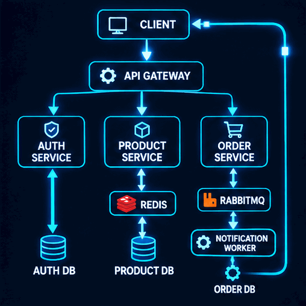
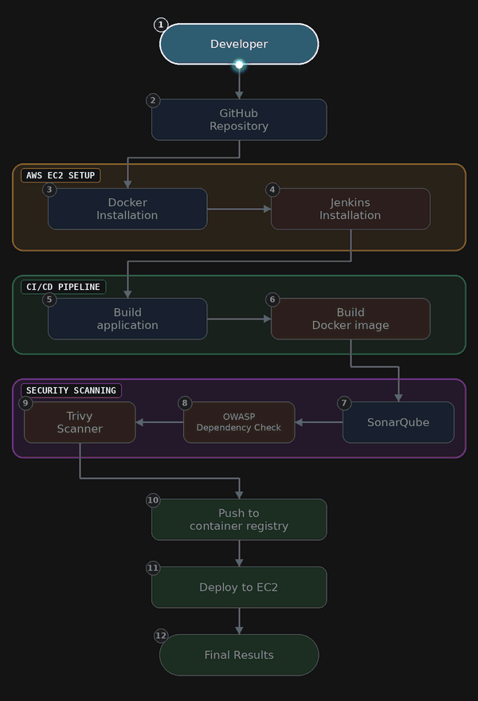

  

---

## 👨‍💻 About Me
<table>
<tr>
<td width="60%" valign="middle">

Third-year Computer Science undergraduate at **NIT Agartala**,
passionate about backend engineering, distributed systems,
and cloud-native infrastructure.

- 🚀 Backend development with Golang, REST APIs and gRPC.
- ⚙️ Building distributed systems using RabbitMQ, Redis and PostgreSQL.
- ☁️ Cloud infrastructure with AWS, Kubernetes and Terraform.
- 🔄 CI/CD, GitOps, monitoring and DevSecOps.
- 🌐 Full-stack development with React, Next.js and TypeScript.
- 🧠 Practicing DSA and system design.

**Areas of Interest:** Backend Engineering | Distributed Systems |
Cloud Computing | DevOps

</td>

<td width="40%" align="center" valign="middle">

</td>
</tr>
</table>

<table>
<tr>
<td width="60%" valign="middle">

## 🛠️ Technical Skills
### 💻 Programming Languages

  
  
  
  
  
  

### ⚡ Backend & Distributed Systems

  
  
  
  
  
  
  
  

### 🗄️ Databases & Caching

  
  
  
  

### ☁️ Cloud, DevOps & Infrastructure

  
  
  
  
  
  
  
  

### 📊 Monitoring & Observability

  
  
  

### 🔐 Security & DevSecOps

  
  
  

</td>
<td width="40%" align="center" valign="middle">
 
</td>
</tr>
</table>
---

## 🚀 Featured Projects

### Backend & Full-Stack Development

| Project | Technologies |
|---|---|
| [Anonymous Feedback](https://github.com/Sab-429/Anonymous-feedback) | Next.js, TypeScript, NextAuth, MongoDB, Resend, Docker, Nginx |
| [Placement Cell](https://github.com/Sab-429/placement-cell) | Golang, Gin, React, PostgreSQL, Redis, JWT, Python, RabbitMQ |

### Cloud & DevOps Engineering

| Project | Technologies |
|---|---|
| [Kubernetes Manifests](https://github.com/Sab-429/kubernetes-manifests) | Kubernetes, Helm, HPA, VPA, StatefulSets, RBAC, Ingress, PVC, Monitoring |
| [3-Tier DevSecOps Pipeline](https://github.com/Sab-429/3-Tier-DevSecOps-cicd-Readmefile) | AWS, Docker, Jenkins, SonarQube, Trivy, OWASP |

---

  
  

  

  

---
