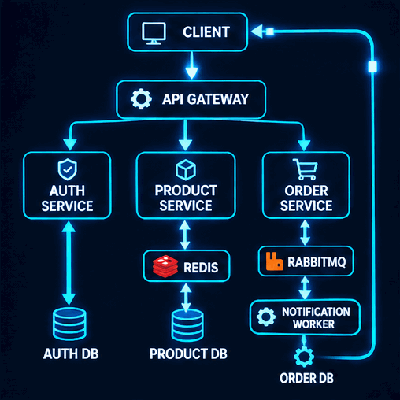

  

---

## 👨‍💻 About Me
<table>
<tr>
<td width="60%" valign="middle">

Third-year Computer Science undergraduate at **NIT Agartala**,
passionate about backend engineering, distributed systems,
and cloud-native infrastructure.

- 🚀 Backend development with Golang, REST APIs and gRPC.
- ⚙️ Building distributed systems using RabbitMQ, Redis and PostgreSQL.
- ☁️ Cloud infrastructure with AWS, Kubernetes and Terraform.
- 🔄 CI/CD, GitOps, monitoring and DevSecOps.
- 🌐 Full-stack development with React, Next.js and TypeScript.
- 🧠 Practicing DSA and system design.

**Areas of Interest:** Backend Engineering | Distributed Systems |
Cloud Computing | DevOps

</td>

<td width="40%" align="center" valign="middle">

</td>
</tr>
</table>

<table>

  

</table>

## 🚀 Featured Projects

### ⚡ Backend & Full-Stack Development

<table>
<tr>
<td colspan="2"></td>
</tr>
<tr>
<th align="left" width="28%">Project</th>
<th align="left" width="72%">Technologies</th>
</tr>
<tr>
<td><a href="https://github.com/Sab-429/Anonymous-feedback"><b>Anonymous Feedback</b></a></td>
<td>Next.js, TypeScript, NextAuth, MongoDB, Resend, Docker, Nginx</td>
</tr>
<tr>
<td><a href="https://github.com/Sab-429/placement-cell"><b>Placement Cell</b></a></td>
<td>Golang, Gin, React, PostgreSQL, Redis, JWT, Python, RabbitMQ</td>
</tr>
<tr>
<td><a href="https://github.com/Sab-429/Distributed-Scalable-Ecommerce-backend"><b>Microservices</b></a></td>
<td>Golang, gRPC, REST APIs, RabbitMQ, PostgreSQL, Redis, Docker, JWT</td>
</tr>
</table>

### ☁️ Cloud & DevOps Engineering

<table>
<tr>
<td colspan="2"></td>
</tr>
<tr>
<th align="left" width="28%">Project</th>
<th align="left" width="72%">Technologies</th>
</tr>
<tr>
<td><a href="https://github.com/Sab-429/kubernetes-manifests"><b>Kubernetes Manifests</b></a></td>
<td>Kubernetes, Helm, HPA, VPA, StatefulSets, RBAC, Ingress, PVC, Monitoring</td>
</tr>
<tr>
<td><a href="https://github.com/Sab-429/3-Tier-DevSecOps-cicd-Readmefile"><b>3-Tier DevSecOps Pipeline</b></a></td>
<td>AWS, Docker, Jenkins, SonarQube, Trivy, OWASP</td>
</tr>
</table>

---

  
  

  

  

---
